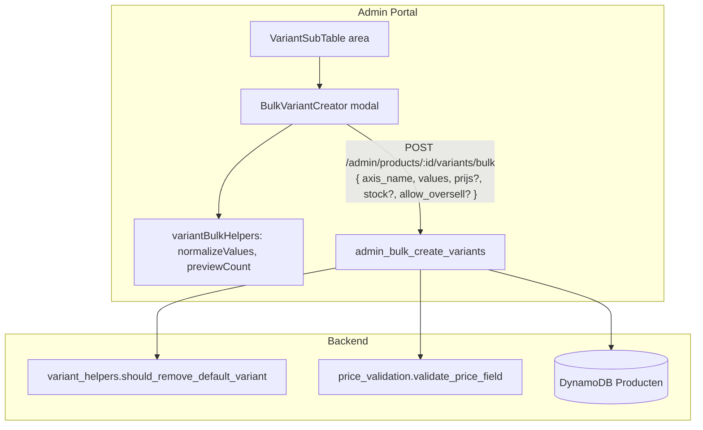

# Design Document: Variant Bulk Generator (single axis)

## Overview

This design adds a single-axis bulk variant generator on top of the
`product-variant-simplification` architecture (variant records are the source of truth; no
`variant_schema` on the parent; webshop derives axes via `deriveAxesFromVariants`).

The admin enters **one axis** (name + a list of values) once; the backend creates one
Variant_Record per value, skipping values that already exist. Defaults per generated record are
`stock = 0`, `allow_oversell = false`, `prijs` inherited from the parent, `active = true`.

**Key changes:**

1. Correct `MAX_AXES` from `2` to `1` in the frontend (aligns the whole create/edit UI to the
   single-axis decision; `determineFormMode` logic is untouched — only the constant).
2. Repurpose the existing but broken `admin_bulk_create_variants` handler: it now reads the axis
   and values from the request body (not from a removed `required_attributes`/`variant_schema` on
   the parent), uses the correct field names (`prijs`, not `price`), enforces single-axis and
   per-request value limits, skips duplicates, and reuses `should_remove_default_variant` and
   `validate_price_field`.
3. Replace the existing `BulkVariantCreator` modal body (which only confirmed and sent `productId`)
   with inputs for one axis name + a value list, a live count preview, and a request body carrying
   the axis and values.
4. Add `bulkCreateVariants` request-body support in the frontend admin API client.

**What stays the same:**

- `VariantSubTable`, `VariantEditModal` (create/edit), `deriveAxesFromVariants`, the webshop
  `VariantSelector`, and the per-variant inline editing remain as delivered by
  `product-variant-simplification` and related specs.
- `admin_create_variant` (single create) is unchanged and remains the reference for record shape,
  duplicate handling, and price validation.

## Prior art and why the existing bulk code does not fit

The repository already contains a bulk stack built for the **old** model:

- `admin_bulk_create_variants/app.py` reads `parent['required_attributes']` and calls
  `generate_variant_combinations(required_attributes)` — but (a) `required_attributes` no longer
  exists after simplification, (b) the helper's real signature is
  `generate_variant_combinations(variant_schema, parent_product_id, channel=None)` (two required
  args), so the call raises `TypeError`, and (c) it writes `price`, not `prijs`.
- `BulkVariantCreator.tsx` + `adminApi.bulkCreateVariants(productId)` only send the product id and
  rely on the parent knowing the axes.

Because the parent no longer stores axes, the **admin must supply the axis + values in the request**.
This design keeps the existing endpoint path and component names but changes their contract.

## Architecture



### Data flow

1. Admin opens the generator from the variant area of a Parent_Product.
2. If the product already has one axis (derived from existing variant records), the axis name is
   pre-filled and locked; otherwise it is free text.
3. Admin enters values; the modal trims, de-duplicates, and shows a live "will create N variants"
   count.
4. On submit, the frontend posts `{ axis_name, values, prijs?, stock?, allow_oversell? }`.
5. Backend loads the parent, validates single-axis + value-count, scans existing variants, skips
   values that already exist, creates the rest, removes the Default_Variant if applicable, and
   returns a summary `{ created, skipped, default_variant_removed }`.
6. Frontend re-fetches variants, closes the modal, and toasts the created/skipped counts.

## Components and Interfaces

### Frontend — constant change

`frontend/src/config/constants.ts`:

```typescript
export const MAX_AXES = 1; // was 2 — single-axis decision
```

No other change to `determineFormMode` / `variantFormHelpers.ts` — they already read `MAX_AXES`.

### Frontend — new pure helpers

`frontend/src/modules/products/utils/variantBulkHelpers.ts`:

```typescript
/** Trim, drop empty/whitespace-only, de-duplicate (case-sensitive), preserve first-seen order. */
export function normalizeValues(raw: string[]): string[];

/** Count of variants that would be created given requested values and already-existing values. */
export function previewCreateCount(
  requestedValues: string[],
  existingValues: string[],
): number;
```

These are pure and property-tested.

### Frontend — BulkVariantCreator (modified contract)

`frontend/src/modules/webshop-management/components/BulkVariantCreator.tsx`:

- New props add the existing axis context derived from current variants:

```typescript
export interface BulkVariantCreatorProps {
  productId: string;
  productName: string;
  existingVariants: AdminVariant[]; // to derive the locked axis + existing values
  onSuccess: () => void;
  isDisabled?: boolean;
}
```

- Body: a (possibly locked) axis-name input + a multi-value entry (textarea one-per-line or tag
  input) + a live preview line ("Er worden N varianten aangemaakt"). All strings via
  `useTranslation('products')`.
- The axis name is locked to the existing axis when `deriveAxesFromVariants(existingVariants)` yields
  one axis; free text when zero axes exist.

### Frontend — admin API client (modified)

`frontend/src/modules/webshop-management/services/adminApi.ts`:

```typescript
export interface BulkCreateVariantsBody {
  axis_name: string;
  values: string[];
  prijs?: number | null;
  stock?: number;
  allow_oversell?: boolean;
}

export interface BulkCreateVariantsResult {
  created: number;
  skipped: string[];
  default_variant_removed: boolean;
}

export const bulkCreateVariants = async (
  productId: string,
  body: BulkCreateVariantsBody,
): Promise<BulkCreateVariantsResult> => {
  const res = await adminClient.post(
    `/admin/products/${encodeURIComponent(productId)}/variants/bulk`,
    body,
  );
  return res.data;
};
```

### Backend — admin_bulk_create_variants (rewritten contract)

`backend/handler/admin_bulk_create_variants/app.py`:

- Imports: `extract_user_credentials`, `validate_permissions_with_regions`, response helpers,
  `log_successful_access`, `should_remove_default_variant`, `validate_price_field`. Keep the
  maintenance-fallback import guard pattern.
- Table name from `os.environ.get('PRODUCTEN_TABLE_NAME', 'Producten')`.
- Request body: `{ axis_name: str, values: [str], prijs?, stock?, allow_oversell? }`.

Handler steps:

1. OPTIONS → `handle_options_request()`.
2. Auth: `extract_user_credentials` → `validate_permissions_with_regions(roles, ['Products_CRUD'], ...)`.
3. `product_id` from path; 400 if missing.
4. `get_item` parent; 404 if absent; 400 if `is_parent is False`.
5. Parse body. Validate:
   - `axis_name` non-empty after trim → else 400.
   - `values` is a non-empty list; trim, drop empties, de-dup → else 400 if empty after cleaning.
   - value count ≤ `MAX_VALUES_PER_AXIS` (20) → else 400.
6. Scan existing variants for the parent (`parent_id == product_id AND is_parent == False`).
   - Derive existing axis name(s) from existing `variant_attributes` keys. If an existing axis
     exists and differs from `axis_name` → 400 "product already uses a different axis".
   - Build the set of existing values for that axis.
7. Optional overrides: validate `prijs` via `validate_price_field` when provided (else inherit via
   `parent.get('prijs')`); default `stock = 0`, `allow_oversell = False`.
8. For each cleaned value not already present: build a Variant_Record identical in shape to
   `admin_create_variant`'s (`product_id = f"var_{uuid4().hex[:12]}"`, `naam=''`, `is_parent=False`,
   `variant_attributes={axis_name: value}`, `prijs`, `stock`, `sold_count=0`, `allow_oversell`,
   `active=True`, timestamps) and `put_item`.
   - Collect created records and skipped (already-existing) values.
9. `should_remove_default_variant(existing_variants, created)` → delete `var_{product_id}_default`
   if true; record `default_variant_removed`.
10. Return `create_success_response({ created: len(created), skipped, default_variant_removed, message })`
    with Decimal-safe serialization (reuse the `_serialize_response` pattern from `admin_create_variant`).

Constants in the handler (local, matching the removed-schema limits already documented):

```python
MAX_AXES = 1
MAX_VALUES_PER_AXIS = 20
```

> Note: `generate_variant_combinations` in `variant_helpers.py` is **not** used by this handler
> (single axis makes a cartesian helper unnecessary). We do not revive or re-wire it. It remains
> dead relative to this feature; cleaning it up is out of scope unless the user asks.

### Backend — template.yaml

No structural change needed: `AdminBulkCreateVariantsFunction` is already wired to
`POST /admin/products/{id}/variants/bulk` on `MyApi` with the shared role. Confirm it passes
`PRODUCTEN_TABLE_NAME` in its `Environment.Variables`; add it if missing (matching
`admin_create_variant`).

## Data Models

### Variant_Record created by the generator (single axis)

| Field              | Type                | Value                                |
| ------------------ | ------------------- | ------------------------------------ |
| product_id         | String (PK)         | `var_<uuid12>`                       |
| parent_id          | String              | Parent `product_id`                  |
| naam               | String              | `''`                                 |
| is_parent          | Boolean             | `false`                              |
| variant_attributes | Map<String,String>  | `{ <axis_name>: <value> }` (1 pair)  |
| prijs              | Number \| null      | override or inherit (null) from parent |
| stock              | Number              | `0` (or override)                    |
| sold_count         | Number              | `0`                                  |
| allow_oversell     | Boolean             | `false` (or override)                |
| active             | Boolean             | `true`                               |
| created_at/updated_at | String (ISO)     | now                                  |

No new fields and no field renames — all keys already exist in the product field registry
(`frontend/src/config/productFields/`). No SKU/article-code field is added.

## Correctness Properties

### Property 1: Value normalization

_For any_ list of raw strings, `normalizeValues` SHALL return a list containing each non-empty
trimmed value exactly once, in first-seen order, with no empty/whitespace-only entries.

**Validates: Requirements 3.4, 3.5**

### Property 2: Preview count equals values that would be created

_For any_ requested values and existing values, `previewCreateCount` SHALL equal the number of
normalized requested values that are not present in the existing set.

**Validates: Requirements 3.7, 5.2**

### Property 3: Generation creates exactly the non-duplicate values

_For any_ set of existing variants for a parent and any list of requested values, the backend SHALL
create one Variant_Record for each normalized requested value whose `variant_attributes` is not
already present, and SHALL create none for values that already exist.

**Validates: Requirements 5.1, 5.2**

### Property 4: Each generated record has the submitted axis/value and default fields

_For any_ created Variant_Record, its `variant_attributes` SHALL equal `{ axis_name: value }` and
its `stock`, `allow_oversell`, `active`, `sold_count`, `is_parent`, `parent_id` SHALL equal the
specified defaults (absent overrides).

**Validates: Requirements 4.1–4.5**

### Property 5: Single-axis enforcement

_For any_ request whose `axis_name` differs from an existing axis on the parent, the backend SHALL
return 400 and create nothing.

**Validates: Requirements 6.2**

### Property 6: Idempotence

_For any_ request, running it twice SHALL create records only on the first run; the second run SHALL
create zero and report all values as skipped.

**Validates: Requirements 5.1, 5.4**

## Error Handling

| Scenario                               | Component          | Behavior                                                       |
| -------------------------------------- | ------------------ | -------------------------------------------------------------- |
| Empty axis name / no values after trim | BulkVariantCreator | Disable submit, show validation message                        |
| Axis differs from existing (400)       | BulkVariantCreator | Toast backend message, keep modal open, values preserved       |
| Too many values (400)                  | BulkVariantCreator | Toast "max 20 waarden", keep modal open                        |
| All values already exist               | BulkVariantCreator | Success toast "0 aangemaakt, N overgeslagen", close + refresh  |
| Network/5xx                            | BulkVariantCreator | Error toast, keep modal open, values preserved                 |
| Missing product_id                     | Variant_API        | 400                                                            |
| Parent not found                       | Variant_API        | 404                                                            |
| Non-parent product                     | Variant_API        | 400                                                            |
| Invalid prijs override                 | Variant_API        | 400 via `validate_price_field`                                 |

### Backend responses

| Endpoint                           | Status | Condition                                             |
| ---------------------------------- | ------ | ----------------------------------------------------- |
| POST /admin/products/{id}/variants/bulk | 200 | Created ≥ 0, with `{ created, skipped, default_variant_removed }` |
| "                                  | 400    | Missing/empty axis, no values, > 20 values, axis mismatch, bad prijs |
| "                                  | 404    | Parent not found                                      |
| "                                  | 403    | Missing `Products_CRUD` (via auth layer)              |

## Testing Strategy

Follow `testing-frontend.md` (always `--watchAll=false --testPathPattern`, `npx tsc --noEmit`) and
`testing-backend.md` (`importlib.util` handler load, `mock_aws` context, patch auth as `'app'`).

### Property-Based Tests (fast-check — Frontend)

| Property                | Test File                                              | Target                  |
| ----------------------- | ------------------------------------------------------ | ----------------------- |
| P1: Normalization       | `__tests__/variantBulkHelpers.property.test.ts`        | `normalizeValues`       |
| P2: Preview count       | `__tests__/variantBulkHelpers.property.test.ts`        | `previewCreateCount`    |

### Property-Based Tests (hypothesis — Backend)

| Property                | Test File                                                       | Target           |
| ----------------------- | --------------------------------------------------------------- | ---------------- |
| P3: Non-duplicate create| `tests/unit/test_admin_bulk_create_variants_properties.py`      | `lambda_handler` |
| P4: Record shape        | `tests/unit/test_admin_bulk_create_variants_properties.py`      | `lambda_handler` |
| P5: Single-axis         | `tests/unit/test_admin_bulk_create_variants_properties.py`      | `lambda_handler` |
| P6: Idempotence         | `tests/unit/test_admin_bulk_create_variants_properties.py`      | `lambda_handler` |

### Unit Tests

| Test                                                        | File                                               |
| ----------------------------------------------------------- | -------------------------------------------------- |
| MAX_AXES === 1                                              | `frontend/src/config/__tests__/constants.test.ts`  |
| determineFormMode returns at-max with 1 existing axis       | `products/utils/__tests__/variantFormHelpers.test.ts` (update) |
| BulkVariantCreator locks axis when one exists               | `webshop-management/__tests__/BulkVariantCreator.test.tsx` |
| BulkVariantCreator disables submit on empty input           | same                                               |
| BulkVariantCreator posts axis_name + normalized values      | same                                               |
| Handler skips existing values, creates the rest             | `backend/tests/unit/test_admin_bulk_create_variants.py` |
| Handler rejects differing axis (400)                        | same                                               |
| Handler rejects > 20 values (400)                           | same                                               |
| Handler removes Default_Variant when applicable             | same                                               |
| prijs inherits parent when no override                      | same                                               |

### Smoke checks

| Check                                                   | Verification                     |
| ------------------------------------------------------- | -------------------------------- |
| `generate_variant_combinations` not imported by handler | grep handler file                |
| No `variant_schema` / `required_attributes` references reintroduced | grep handler file   |
| MAX_AXES = 1 everywhere it is read                      | grep `MAX_AXES`                  |
