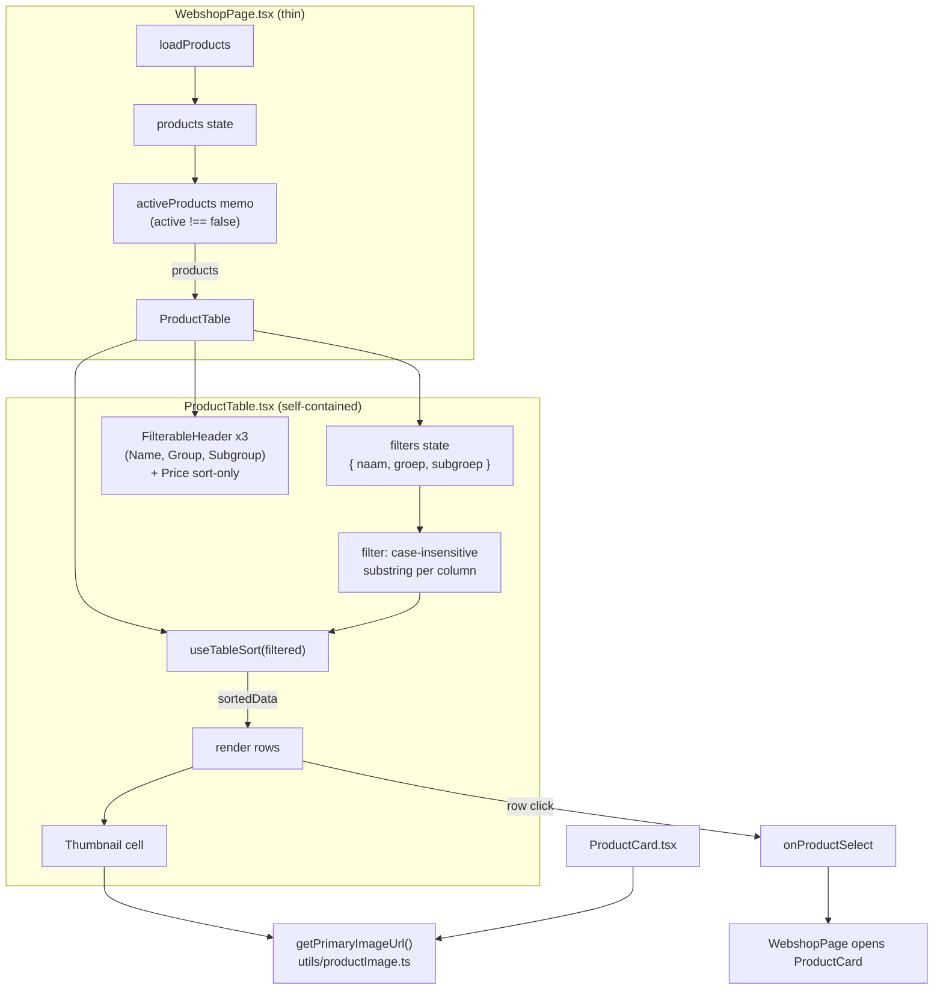

# Design Document: Webshop Table Improvements

## Overview

This is a **frontend-only** change to the **public webshop product table**
(`frontend/src/modules/webshop/components/ProductTable.tsx`) and the parts of
`WebshopPage.tsx` that feed it. No backend, DynamoDB, or API change is in scope — the webshop
product list already returns `images`, `groep`, and `subgroep`.

The feature makes four scoped changes:

1. **Apply the Table_Framework to the public table.** Replace the plain `<Th>` headers with
   `FilterableHeader` columns and wire sorting through the `useTableSort` hook, giving Name,
   Group, and Subgroup an inline text filter + sort toggle, and Price a sort toggle only.
2. **Remove the left-side `FilterPanel`.** Delete the 300px filter column and its supporting
   `selectedGroep` / `selectedSubgroep` state and `groepOptions` / `subgroepOptions` memos.
   The table now spans full width and discovery happens in-column.
3. **Remove the "Opties" column** (the `is_parent ? 'Varianten' : 'Standaard'` label).
4. **Add a product thumbnail** as the leading column, using the first product image via a new
   shared `Image_Url_Helper` extracted from `ProductCard.tsx`.

**Key design decision — state ownership.** The `useTableSort` hook and the per-column filter
state live **inside `ProductTable.tsx`**, not in `WebshopPage`. `ProductTable` becomes
self-contained: it receives the full list of Active_Products and owns filter-then-sort internally.
This keeps `WebshopPage` thin (it only loads products and applies the `active !== false` filter)
and matches the Table_Framework intent where a table component owns its own sort/filter UI.

**What stays the same:**

- Row click-to-open behavior (`onProductSelect`) is preserved.
- The dark-theme look (gray.800 wrapper, orange accents) is preserved.
- `ProductCard.tsx` behavior is unchanged — it is refactored to call the shared helper, producing
  an identical image list.
- Existing field names (`naam`, `groep`, `subgroep`, `prijs`, `images`, `is_parent`) are reused;
  no new or renamed fields.

## Prior art and verified APIs

The real APIs differ slightly from first-glance expectations, so the design pins them down:

- **`useTableSort(data, defaultField?, defaultDirection?)`** (`frontend/src/hooks/useTableSort.ts`)
  returns `{ sortField, sortDirection, handleSort, sortedData, getSortIndicator }`. It takes the
  data array as its first argument and returns `sortedData` (not a `sortData` function). Sorting is
  immutable (`[...data].sort`), nullish values always sort to end regardless of direction, numbers
  compare numerically, ISO date strings chronologically, and everything else via
  `localeCompare(..., { sensitivity: 'base' })`.
- **`FilterableHeader`** (`frontend/src/components/filters/FilterableHeader.tsx`) renders a Chakra
  `<Th>` (so it must sit directly inside a `<Tr>` in `<Thead>`). Props used here: `label`,
  `filterValue` (omit to hide the filter input), `onFilterChange`, `sortable`, `sortDirection`
  (the current field's direction or `null`), `onSort`, `placeholder`, `isNumeric`, and the
  layout props `w` / `minW` / `maxW` / `display`. It already styles itself for the dark theme
  (gray.700 bg, gray.300 label, orange.300 sort arrow).
- **`formatPrice(value)`** (`frontend/src/utils/formatPrice.ts`) safely converts a string/number/
  null `prijs` into a `€X.XX` string. The table uses this instead of `Number(prijs).toFixed(2)`.

## Architecture



### Data flow

1. `WebshopPage` loads products and derives `activeProducts` (`active !== false`), passing the full
   active list to `ProductTable`. No group/subgroup pre-filter remains.
2. `ProductTable` holds `filters = { naam, groep, subgroep }` and `useTableSort`.
3. On render it applies **filter first** (case-insensitive substring per active column filter,
   combined with AND), **then sort** via `useTableSort(filteredRows)`.
4. Each row renders a thumbnail cell (from `getPrimaryImageUrl`), name, group, subgroup, price.
5. Clicking a row calls `onProductSelect(product)`, which opens the existing `ProductCard`.

## Components and Interfaces

### New shared helper — `getPrimaryImageUrl`

**Location: `frontend/src/utils/productImage.ts`.**

Justification: the existing cross-cutting, pure, DynamoDB-field helpers (`formatPrice.ts`,
`productHelpers.ts`) all live in `frontend/src/utils/`. The image normalizer is consumed by both
`ProductTable` and `ProductCard` (Req 5.5) and is a pure function with no webshop-specific
dependency, so the shared `utils/` folder — not a webshop-module-local `utils/` — is the correct
home and keeps it discoverable alongside `formatPrice`.

```typescript
/** Minimal shape the helper reads — accepts a product or just its image fields. */
export interface ProductImageFields {
  images?: unknown;        // expected string[] but defensively typed
  image?: unknown;         // legacy: string | string[]
}

/**
 * Normalize a product's image data to the first usable, fully-qualified URL.
 *
 * - Accepts `images` (array) or legacy `image` (string | string[]).
 * - Flattens to a string list, dropping non-string / empty entries.
 * - Applies the bucket URL fix: `https://my-hdcn-bucke` →
 *   `https://my-hdcn-bucket.s3.eu-west-1.amazonaws.com` (leaves already-correct URLs untouched).
 * - Returns the first resulting URL, or `null` when none exists.
 *
 * Pure and property-testable. Never throws on malformed input.
 */
export function getPrimaryImageUrl(product: ProductImageFields): string | null;
```

Behavior mirrors the current inline `ProductCard` logic exactly:

- `imageData = product.images ?? product.image`.
- If array → use as-is; if string → wrap in a single-element array; otherwise → empty list.
- Map each entry: if it already starts with the full bucket host, keep it; else if it starts with
  `https://my-hdcn-bucke`, replace that prefix with the full host; else keep as-is.
- `filter` to non-empty strings.
- Return `list[0] ?? null`.

### `ProductCard.tsx` refactor (behavior identical)

The inline block (~lines 138–168) that builds `images: string[]` is replaced by a call that reuses
the shared helper's normalization. Because `ProductCard` needs the **full** list (it has a
carousel), the helper is factored so the array step is reusable. Two options, pick the simpler:

- Preferred: keep `getPrimaryImageUrl` as the public helper and additionally export a
  `normalizeProductImages(product): string[]` that `getPrimaryImageUrl` calls internally
  (`getPrimaryImageUrl` returns `normalizeProductImages(product)[0] ?? null`). `ProductCard` uses
  `normalizeProductImages` to populate its `images` array; the table uses `getPrimaryImageUrl`.

```typescript
export function normalizeProductImages(product: ProductImageFields): string[];
export function getPrimaryImageUrl(product: ProductImageFields): string | null; // = normalize(...)[0] ?? null
```

This keeps `ProductCard`'s carousel behavior byte-for-byte identical while satisfying Req 5
(single source of truth) and Req 5.5 (table uses the helper, not inline logic).

### `ProductTable.tsx` (rewritten)

Props are unchanged:

```typescript
interface ProductTableProps {
  products: Product[];                      // already filtered to Active_Products by WebshopPage
  onProductSelect: (product: Product) => void;
}
```

Internal state and composition:

```typescript
const { t } = useTranslation('products');

const [filters, setFilters] = useState<{ naam: string; groep: string; subgroep: string }>(
  { naam: '', groep: '', subgroep: '' },
);
const setFilter = (key: keyof typeof filters, value: string) =>
  setFilters((f) => ({ ...f, [key]: value }));

// 1) Filter: case-insensitive substring, AND across active filters.
//    A row whose field is absent/null/undefined is non-matching for any non-empty filter.
const filtered = useMemo(
  () => products.filter((p) => matchesFilters(p, filters)),
  [products, filters],
);

// 2) Sort: useTableSort owns sortField/sortDirection and returns sortedData.
const { sortField, sortDirection, handleSort, sortedData } = useTableSort<Product>(filtered);
```

`matchesFilters` is a small local pure helper (also unit/property-testable):

```typescript
function fieldMatches(value: unknown, filter: string): boolean {
  if (filter === '') return true;                 // empty filter matches all
  if (typeof value !== 'string') return false;    // absent/null/undefined/non-string → no match
  return value.toLowerCase().includes(filter.toLowerCase());
}
function matchesFilters(p: Product, f: { naam: string; groep: string; subgroep: string }): boolean {
  return fieldMatches(p.naam, f.naam)
    && fieldMatches(p.groep, f.groep)
    && fieldMatches(p.subgroep, f.subgroep);
}
```

Header row (inside `<Thead><Tr>` — each `FilterableHeader` renders a `<Th>`):

| Column    | Component         | sortable | filter | field      | responsive `display`                          |
| --------- | ----------------- | -------- | ------ | ---------- | --------------------------------------------- |
| Thumbnail | plain `<Th>`      | no       | no     | —          | always visible                                |
| Name      | `FilterableHeader`| yes      | yes    | `naam`     | always visible (`w="40%"`)                    |
| Group     | `FilterableHeader`| yes      | yes    | `groep`    | `{ base: 'none', md: 'table-cell' }`          |
| Subgroup  | `FilterableHeader`| yes      | yes    | `subgroep` | `{ base: 'none', lg: 'table-cell' }`          |
| Price     | `FilterableHeader`| yes      | no     | `prijs`    | always visible, `isNumeric`                   |

Example header wiring (Name; Group/Subgroup analogous, Price omits `filterValue`/`onFilterChange`):

```tsx
<Thead bg="gray.700">
  <Tr>
    <Th color="orange.300" w="56px" aria-hidden />           {/* thumbnail, not sortable/filterable */}
    <FilterableHeader
      label={t('table.name')}
      filterValue={filters.naam}
      onFilterChange={(v) => setFilter('naam', v)}
      sortable
      sortDirection={sortField === 'naam' ? sortDirection : null}
      onSort={() => handleSort('naam')}
      placeholder={t('table.filter_name')}
      w="40%"
    />
    {/* Group: display={{ base: 'none', md: 'table-cell' }} on field 'groep' */}
    {/* Subgroup: display={{ base: 'none', lg: 'table-cell' }} on field 'subgroep' */}
    <FilterableHeader
      label={t('table.price')}
      sortable
      sortDirection={sortField === 'prijs' ? sortDirection : null}
      onSort={() => handleSort('prijs')}
      isNumeric
      minW="80px"
    />
  </Tr>
</Thead>
```

> Note: omitting `filterValue` on the Price header hides its filter input (per `FilterableHeader`),
> giving Price a sort toggle only (Req 1.3). The responsive `display` on Group/Subgroup headers
> must match the `display` on the corresponding body `<Td>` so the column collapses consistently.

Body rows (per product) keep the clickable behavior and add the thumbnail cell:

```tsx
{sortedData.map((product) => {
  const imageUrl = getPrimaryImageUrl(product);
  return (
    <Tr key={product.product_id} cursor="pointer"
        _hover={{ bg: 'orange.500', color: 'white' }}
        onClick={() => onProductSelect(product)} color="white">
      <Td>
        {imageUrl && (
          <Image
            src={imageUrl}
            alt={product.naam || t('table.thumbnail_alt')}
            boxSize="48px"
            objectFit="cover"
            borderRadius="md"
          />
        )}
      </Td>
      <Td fontWeight="medium">{product.naam || ''}</Td>
      <Td display={{ base: 'none', md: 'table-cell' }}>
        <Text isTruncated maxW="100px">{product.groep}</Text>
      </Td>
      <Td display={{ base: 'none', lg: 'table-cell' }}>
        <Text isTruncated maxW="100px">{product.subgroep}</Text>
      </Td>
      <Td isNumeric>{formatPrice(product.prijs)}</Td>
    </Tr>
  );
})}
```

When `imageUrl` is `null`, the cell renders **nothing** (no `<Image>`, no broken-image icon) —
an empty `<Td>` (Req 4.4, 4.5). The Opties `<Th>` and `<Td>` are fully removed (Req 3). Price uses
`formatPrice` rather than `.toFixed()` (Req 6.2).

### `WebshopPage.tsx` cleanup

Remove:

- Imports: `FilterPanel`, `FilterConfig` (and `GenericFilter`/`useMemo` if they become unused —
  `useMemo` stays only if the `activeProducts` memo uses it, which it does).
- State: `selectedGroep`, `selectedSubgroep`.
- The `groepOptions` / `subgroepOptions` memo entirely.
- The `FilterPanel` JSX block and its surrounding 300px `<Box w={{ ..., lg: '300px' }}>`.
- The group/subgroup branches of `filteredProducts`.

Replace `filteredProducts` with an `activeProducts` memo that **only** keeps Active_Products:

```typescript
const activeProducts = useMemo(
  () => products.filter((p) => p.active !== false),   // strict comparison (Req 6.3)
  [products],
);
```

Collapse the layout — the `Stack` with the left filter box becomes a single full-width table box:

```tsx
<Box>
  <ProductTable
    products={activeProducts}
    onProductSelect={(product) => { setSelectedProduct(product); setIsProductCardOpen(true); }}
  />
</Box>
```

The `filter.group` / `filter.subgroup` / `filter.all_groups` / `filter.all_subgroups` translation
keys become unreferenced by `WebshopPage` (they may remain in the locale files; Req 7.4 analog).

## Data Models

No DynamoDB or API change. The table reads these existing product fields via the registry names
(`frontend/src/config/productFields/`):

| Field       | Type (DynamoDB)        | Used for                         | Safety handling                               |
| ----------- | ---------------------- | -------------------------------- | --------------------------------------------- |
| `product_id`| String                 | React key, selection             | —                                             |
| `naam`      | String                 | Name column + filter/sort        | absent → non-matching filter, sorts to end    |
| `groep`     | String                 | Group column + filter/sort       | absent → non-matching filter, sorts to end    |
| `subgroep`  | String                 | Subgroup column + filter/sort    | absent → non-matching filter, sorts to end    |
| `prijs`     | Number \| String \| null | Price column + sort            | `formatPrice()` coerces safely; nulls to end  |
| `images`    | List<String>           | Thumbnail (first entry)          | via `getPrimaryImageUrl` → `null` when none   |
| `image`     | String \| List<String> | Legacy thumbnail fallback        | via `getPrimaryImageUrl`                       |
| `is_parent` | Boolean                | (no longer rendered — removed)   | —                                             |
| `active`    | Boolean                | WebshopPage active filter        | strict `active !== false` (Req 6.3)           |

The `Product` interface in `ProductTable.tsx` is extended to include `images?: string[]` and
`image?: string | string[]` and loses no existing fields; `is_parent` may remain in the type but is
no longer rendered.

## Correctness Properties

_A property is a characteristic or behavior that should hold true across all valid executions of a
system — a formal statement about what the system should do. Properties serve as the bridge between
human-readable specifications and machine-verifiable correctness guarantees._

The pure, input-varying logic here is (a) `getPrimaryImageUrl` / `normalizeProductImages` and
(b) the table's filter-then-sort composition (`matchesFilters` + `useTableSort`). These are suitable
for property-based testing. The thumbnail rendering, FilterableHeader layout, and WebshopPage
cleanup are UI/structural and are covered by example-based React Testing Library tests instead.

### Property 1: Helper returns null or a non-empty string

_For any_ product image input (absent, `null`, non-string entries, empty array, empty strings,
nested arrays, or valid strings), `getPrimaryImageUrl` SHALL return either `null` or a non-empty
string, and SHALL NOT throw.

**Validates: Requirements 5.1, 5.4, 4.5**

### Property 2: No usable image yields null

_For any_ product whose image data is absent, `null`, an empty array, or contains only non-string
or empty-string entries, `getPrimaryImageUrl` SHALL return `null`.

**Validates: Requirements 4.5, 5.4**

### Property 3: Bucket URL correction

_For any_ image list whose first usable entry begins with `https://my-hdcn-bucke` (but not the full
host), `getPrimaryImageUrl` SHALL return that entry with the prefix rewritten to
`https://my-hdcn-bucket.s3.eu-west-1.amazonaws.com`; an entry already beginning with the full host
SHALL be returned unchanged.

**Validates: Requirements 5.3**

### Property 4: Filter yields an ordered subset

_For any_ product list and any filter state, the table's displayed rows SHALL be a subset of the
input products, preserving the order produced by `useTableSort` for the active sort (no duplicates,
no rows not present in the input).

**Validates: Requirements 1.4, 1.5, 1.6**

### Property 5: Absent field never matches a non-empty filter

_For any_ product whose filtered field (`naam`, `groep`, or `subgroep`) is absent, `null`, or
`undefined`, that product SHALL NOT appear in the results when a non-empty filter is active on that
field, and evaluating the filter SHALL NOT throw.

**Validates: Requirements 1.7, 4.5**

### Property 6: Conjunctive filtering

_For any_ product list and any combination of column filter values, a product SHALL appear in the
results if and only if it matches **every** active (non-empty) column filter, matched
case-insensitively as a substring.

**Validates: Requirements 1.4, 1.6**

### Property 7: Empty filters, no sort is identity over active products

_For any_ product list, when all column filters are empty and no sort is active, the table SHALL
display exactly the input products in their original order.

**Validates: Requirements 1.6, 2.4**

## Error Handling

| Scenario                                   | Component        | Behavior                                                        |
| ------------------------------------------ | ---------------- | --------------------------------------------------------------- |
| Product has no usable image                | ProductTable     | Empty thumbnail `<Td>`; no `<Image>`, no broken-image icon       |
| Malformed image data (non-string, nested)  | getPrimaryImageUrl | Returns `null`; never throws                                   |
| `naam`/`groep`/`subgroep` absent or null   | ProductTable     | Non-matching for non-empty filter; sorts to end (via useTableSort) |
| `prijs` null / non-numeric string          | ProductTable     | `formatPrice` renders `€0.00`; no `.toFixed` on raw field        |
| Empty filtered result set                  | ProductTable     | Renders an empty `<Tbody>` (no error, no crash)                  |
| No products passed in                      | ProductTable     | Renders headers with an empty body                               |

No network or backend error paths are introduced — this feature performs no I/O.

## Testing Strategy

Follow `.kiro/steering/testing-frontend.md`: always run targeted tests with
`npx react-scripts test --watchAll=false --testPathPattern="..."`, type-check with
`npx tsc --noEmit`, and never run the full suite in automation. Property tests use `fast-check`.

**Required build gate (call out explicitly):** before marking work done, run
`CI=true npm run build` from `frontend/`. CRA treats ESLint warnings as errors under CI, and an
unaddressed warning previously broke a deploy. Removing imports/state in `WebshopPage` and
rewriting `ProductTable` must leave **no** unused-import / unused-var warnings. Also run
`npx eslint` on every modified file.

PBT applies to the two pure layers only; everything UI/structural uses example-based RTL tests.

### Property-Based Tests (fast-check)

| Property                              | Test file                                              | Target                        |
| ------------------------------------- | ------------------------------------------------------ | ----------------------------- |
| P1 Null-or-non-empty                  | `utils/__tests__/productImage.property.test.ts`        | `getPrimaryImageUrl`          |
| P2 No image → null                    | `utils/__tests__/productImage.property.test.ts`        | `getPrimaryImageUrl`          |
| P3 Bucket URL correction              | `utils/__tests__/productImage.property.test.ts`        | `getPrimaryImageUrl`          |
| P4 Ordered subset                     | `webshop/components/__tests__/productTableLogic.property.test.ts` | `matchesFilters` + sort |
| P5 Absent field non-matching          | `webshop/components/__tests__/productTableLogic.property.test.ts` | `matchesFilters`        |
| P6 Conjunctive filtering              | `webshop/components/__tests__/productTableLogic.property.test.ts` | `matchesFilters`        |
| P7 Empty filters identity             | `webshop/components/__tests__/productTableLogic.property.test.ts` | filter+sort composition |

Each property test runs a minimum of **100 iterations** and is tagged with a comment:
`// Feature: webshop-table-improvements, Property N: <property text>`. To make P4–P7 property-
testable without rendering, the filter composition (`matchesFilters`) is a pure exported function;
the sort step reuses the already-tested `useTableSort`/`compareValues`, so properties assert over
`matchesFilters` + a direct `sortedData` equivalent rather than DOM output.

### Unit / Component Tests (React Testing Library)

| Test                                                                     | File                                                        |
| ------------------------------------------------------------------------ | ----------------------------------------------------------- |
| Renders a thumbnail when the product has a usable image                  | `webshop/components/__tests__/ProductTable.test.tsx`        |
| Renders no `` (and no broken-image icon) when there is no image     | same                                                        |
| Typing in the Name filter shows only matching rows (case-insensitive)    | same                                                        |
| Clicking the Name header toggles sort asc → desc → none                  | same                                                        |
| Multiple active filters combine with AND                                 | same                                                        |
| No "Opties" column header or cell is rendered                            | same                                                        |
| Clicking a row still calls `onProductSelect` with the product            | same                                                        |
| Price renders via `formatPrice` (e.g. null `prijs` → `€0.00`)            | same                                                        |
| `normalizeProductImages` matches the previous ProductCard image list     | `webshop/components/__tests__/ProductCard.images.test.tsx`  |
| WebshopPage renders the table full-width with no FilterPanel             | `webshop/__tests__/WebshopPage.test.tsx` (if present)       |
| WebshopPage passes only Active_Products (`active !== false`)             | same                                                        |

### i18n

- All table labels, filter placeholders, and the thumbnail alt text use `useTranslation('products')`
  `table.*` keys. Reuse `table.name` / `table.group` / `table.subgroup` / `table.price`.
- New keys to add to **all 8 locales** (nl, en, de, fr, es, it, da, sv) in **both**
  `frontend/src/locales/{lang}/products.json` and `frontend/public/locales/{lang}/products.json`:
  `table.filter_name`, `table.filter_group`, `table.filter_subgroup`, `table.thumbnail_alt`.
- `table.options` becomes unreferenced by the component (may remain defined in locale files; Req 7.4).

### Type and lint checks

- `npx tsc --noEmit` (frontend) — must pass.
- `npx eslint` on `ProductTable.tsx`, `WebshopPage.tsx`, `ProductCard.tsx`, `utils/productImage.ts`.
- `CI=true npm run build` — must pass with zero warnings (the deploy gate).
